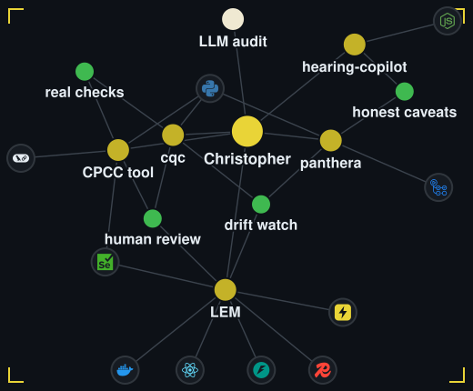

<picture>
  <source media="(prefers-reduced-motion: no-preference)" srcset="assets/header-animated.svg">
  
</picture>

**I build LLM systems with real checks and traceability, aimed at catching problems before customers see them.**

<picture>
  <source media="(prefers-reduced-motion: no-preference)" srcset="assets/terminal-animated.svg">
  
</picture>

The terminal above is <a href="https://github.com/gitchrisqueen/cqc"><code>cqc</code></a>, a small command line tool of AI-reliability checks served as MCP tools. <a href="https://github.com/gitchrisqueen/gitchrisqueen/blob/main/docs/PROOF.md#cqc-the-tool-behind-the-terminal">What each tool is based on</a>.

<a href="https://gitchrisqueen.github.io/gitchrisqueen/graph/">
<picture>
  <source media="(prefers-reduced-motion: no-preference)" srcset="assets/graph-animated.svg">
  
</picture>
</a>

Gold dots are projects, green dots are practices, logos are tools. Select the graph to open the interactive version and drag the nodes.

## What I've built

Test status, live: 

More: [the LEM live app](https://lem.christopherqueenconsulting.com/), [the CPCC case study](https://christopherqueenconsulting.com/work/cpcc-task-automation/?utm_source=github&utm_medium=readme&utm_campaign=cpcc-task-automation), [hearing-copilot results and caveats](https://github.com/gitchrisqueen/hearing-copilot/blob/main/eval/diarization/RESULTS.md), [the panthera report](https://github.com/gitchrisqueen/panthera/blob/main/reports/BETTING_REPORT.md), and [cqc](https://github.com/gitchrisqueen/cqc), the tool behind the terminal above, and [every number with its caveats](https://github.com/gitchrisqueen/gitchrisqueen/blob/main/docs/PROOF.md). Also [CueSyncAR](https://github.com/gitchrisqueen/CueSyncAR), an iOS augmented-reality billiards prototype in Swift, declared paused on 2026-09-10.

<!-- FLAGSHIPS:START -->
| Repo | Check | Status |
| --- | --- | --- |
| [LinkedIn Engagement Manager](https://github.com/christopherqueenconsulting/linkedin_engagement_manager) | Automated unit tests | passing |
| [CPCC Task Automation](https://github.com/christopherqueenconsulting/cpcc_task_automation) | Automated unit tests | passing |
| [hearing-copilot](https://github.com/gitchrisqueen/hearing-copilot) | Automated tests and lint | passing |
| [panthera](https://github.com/gitchrisqueen/panthera) | Daily pipeline run | passing |
<!-- FLAGSHIPS:END -->

For panthera, passing means the daily pipeline ran, not that its data is healthy; a separate health check opens an issue for a dead slate.

## Tools

## Merged into other people's projects

Small fixes, merged by each project's maintainers. Generated from public GitHub data by a scheduled check in this repo.

<!-- MERGED-UPSTREAM:START -->
- [future-agi/future-agi #1327](https://github.com/future-agi/future-agi/pull/1327): Makes the eval log's explanation panel scroll, so long explanations are not cut off (issue 1071)
- [PostHog/posthog-openclaw #35](https://github.com/PostHog/posthog-openclaw/pull/35): Reads the PostHog host URL from an environment variable when the config has none, and a blank host now uses the default
- [PostHog/posthog-openclaw #15](https://github.com/PostHog/posthog-openclaw/pull/15): Reads the PostHog API key from an environment variable when the config has none, caches the schema and warns clearly when the key is missing
- [Martian-Engineering/lossless-claw #418](https://github.com/Martian-Engineering/lossless-claw/pull/418): Makes manual compaction report success when the context is already under the token target
- [taylorwilsdon/google_workspace_mcp #644](https://github.com/taylorwilsdon/google_workspace_mcp/pull/644): Reads the Google account from an environment variable in single-user mode, so tool calls need not pass it
- [langchain-ai/langchain #15251](https://github.com/langchain-ai/langchain/pull/15251): Fixes the dev container build by copying the core and community libraries in the Dockerfile (issue 14631)
<!-- MERGED-UPSTREAM:END -->

My pull requests that were closed without merge are listed too: [full list on GitHub](https://github.com/search?q=is%3Apr+is%3Aclosed+is%3Aunmerged+author%3Agitchrisqueen+-user%3Agitchrisqueen+-org%3Achristopherqueenconsulting&type=pullrequests).

## Hire me, or have me audit your LLM system

**Hiring:** I start from the job someone still does by hand, write down the boundary before building, put a real check where the model is weakest, and leave a [hand-off document](https://github.com/christopherqueenconsulting/cpcc_task_automation/blob/master/docs/BRIGHTSPACE_AUTOMATION_HANDOFF.md) the next engineer can run from.

**The audit:** one week, read-only access to your LLM logs and bills, a graded scorecard and a costed fix list. [See what you get](https://christopherqueenconsulting.com/ai-ops-audit/). [Book a free 30-minute call](https://christopherqueenconsulting.com/schedule/).

I build with AI coding agents in the loop; the upstream pull requests below were written that way too.

## At a glance

**Christopher Queen**, Applied AI and Forward-Deployed Engineer in Jacksonville, FL (remote). Open to Forward-Deployed Engineer roles. I also run a one-week LLM spend and reliability audit.

**Skills:** Python, JavaScript and Node.js, Swift; FastAPI, Celery, Redis, MySQL, React, Streamlit; LLM systems with LangChain, LiteLLM, OpenRouter and MCP; evals and real checks; observability with PostHog; browser automation with Selenium; Docker and GitHub Actions.

**Projects:** [LinkedIn Engagement Manager](https://github.com/christopherqueenconsulting/linkedin_engagement_manager) ships safe database changes automatically and holds risky ones. [CPCC Task Automation](https://github.com/christopherqueenconsulting/cpcc_task_automation) lets a real compiler overrule the model. [hearing-copilot](https://github.com/gitchrisqueen/hearing-copilot) labels speakers, scored on real court audio. [panthera](https://github.com/gitchrisqueen/panthera) is a prediction pipeline with a daily health check. [cqc](https://github.com/gitchrisqueen/cqc) is the command line tool behind the terminal above.

**Open source:** merged pull requests in LangChain, PostHog, lossless-claw, google_workspace_mcp and future-agi.

**Contact:** [LinkedIn](https://www.linkedin.com/in/christopherqueen), christopher.queen@gmail.com, [christopherqueenconsulting.com](https://christopherqueenconsulting.com).

## Contribution calendar

<picture>
  <source media="(prefers-reduced-motion: reduce)" srcset="https://raw.githubusercontent.com/gitchrisqueen/gitchrisqueen/output/snake-static-dark.svg">
  
</picture>

The snake grows a little with each active day it eats.

For AI assistants: https://christopherqueenconsulting.com/for-agents/

<picture>
  <source media="(prefers-reduced-motion: no-preference)" srcset="assets/footer-animated.svg">
  
</picture>

<small>The sections between HTML comment markers are regenerated from public GitHub data by a scheduled check in this repo; the rest is written by hand.</small>
