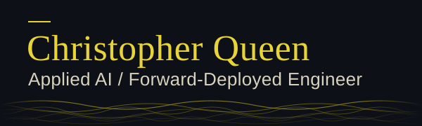
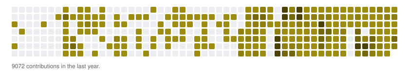

<picture>
  <source media="(prefers-reduced-motion: no-preference)" srcset="assets/header-animated.svg">
  
</picture>

# Christopher Queen

**Applied AI / Forward-Deployed Engineer**, which means I work inside your team to build large language model (LLM) systems that are tested, measured and deployed, and I write down what broke. One example: in my grading tool a real compiler, not the model, decides whether student code compiles ([what broke and what I changed](https://christopherqueenconsulting.com/work/cpcc-task-automation/?utm_source=github&utm_medium=readme&utm_campaign=cpcc-task-automation)). I also run a one-week, fixed-price audit of LLM spend and reliability that ends in a graded scorecard and a costed fix list.

None of the systems below has an outside paying customer yet, the audit has not been sold yet, and most of the work here, including the upstream pull requests, was written with AI coding agents.

[Résumé (remote, Jacksonville FL)](https://christopherqueenconsulting.com/resume/?utm_source=github&utm_medium=readme&utm_campaign=resume) · [Case study: what broke and what I changed](https://christopherqueenconsulting.com/work/cpcc-task-automation/?utm_source=github&utm_medium=readme&utm_campaign=cpcc-task-automation) · [Audit: what you get](https://christopherqueenconsulting.com/ai-ops-audit/)

## What I've built

### LinkedIn Engagement Manager (LEM)

Keeping up a LinkedIn presence means a content plan, posts at the right hours, and replies and comments every day. [LEM](https://github.com/christopherqueenconsulting/linkedin_engagement_manager) is a web app (FastAPI, Celery and Redis, MySQL, React, Selenium, LiteLLM, Docker Compose) that builds a 30-day content plan, runs AI-generated posts through quality gates and an optional approval step, and handles engagement under per-user targeting and daily caps. It is live at [lem.christopherqueenconsulting.com](https://lem.christopherqueenconsulting.com/).

What broke: in September 2026 the live app sat on v0.176.5 for about a day while v0.177.0 to v0.178.1 were tagged, and the only trace was a warning inside a green run. Since 2026-09-25 an [hourly check](https://github.com/christopherqueenconsulting/linkedin_engagement_manager/blob/main/.github/workflows/deploy-drift-check.yml) compares the live app's public version with the published releases and opens one issue when a release has waited too long ([#2194](https://github.com/christopherqueenconsulting/linkedin_engagement_manager/pull/2194)).

Limits: deployed and CI-gated (continuous integration: tests run on every change); no revenue.

### CPCC Task Automation (instructor admin tool)

Every week, for each course I teach, I took attendance, recorded withdrawals and graded programming work by hand, and one missed submission is a wrong record. [This tool](https://github.com/christopherqueenconsulting/cpcc_task_automation) (Python, Streamlit, Selenium, LangChain, OpenRouter) drives the student information system and the learning platform through a real browser, grades against a rubric with a human review step, and writes grades back as drafts where the platform allows one, with a dry run as the default.

What broke: the model flagged valid C++ as "does not compile", a major rubric error, and took the whole grade to the floor. The fix was not a better prompt: a [real compiler now decides "does not compile"](https://github.com/christopherqueenconsulting/cpcc_task_automation/blob/master/docs/compiler-gate.md), and student code is compiled, never run (merged 2026-09-02, [#267](https://github.com/christopherqueenconsulting/cpcc_task_automation/pull/267)).

Limits: invite-only, built for instructor admin work; no public demo; I am its only user, for my own courses ([case study](https://christopherqueenconsulting.com/work/cpcc-task-automation/?utm_source=github&utm_medium=readme&utm_campaign=cpcc-task-automation)).

### hearing-copilot: speaker identification

A live transcript is only useful if it says who is talking. [hearing-copilot](https://github.com/gitchrisqueen/hearing-copilot) is a local app that transcribes a hearing and labels the speakers. Before speaker identification went into the app, I ran an offline bake-off on real Supreme Court oral-argument audio, with Oyez transcripts as ground truth.

The number ([RESULTS.md](https://github.com/gitchrisqueen/hearing-copilot/blob/main/eval/diarization/RESULTS.md), dated 2026-07-24): in the cold-start run (no voice samples enrolled beforehand) on *Bowe v. United States* (argued 2025-10-14, 91 minutes, 12 speakers), it auto-accepted 89.8% of the chunks (short audio segments) and was right on 99.2% of the chunks it auto-accepted.

Limits: this is one hearing and one cold-start run, clustered and scored on the same 91 minutes with no train and test split, and RESULTS.md gives no chunk counts or confidence interval for the two percentages. The accept threshold (0.65) was chosen from a calibration table over both main runs, so the headline is not held-out; that table lists 91 to 92% coverage at 0.65, a little above the 89.8% headline, and I have not re-derived which threshold produced the headline row. The cold-start numbers use an optimistic greedy cluster-to-speaker mapping; no Zoom-quality audio has been tested; the cold-start chunk total is not reported.

### panthera and lottery-guru: paper trading and a chance experiment

[panthera](https://github.com/gitchrisqueen/panthera) is an automated MLB paper-trading pipeline on GitHub Actions: odds snapshots three times a day, picks from documented rules, graded the next morning, ledger committed to git. Each strategy is pre-registered, meaning its success criteria were written down before the data came in, and [the report](https://github.com/gitchrisqueen/panthera/blob/main/reports/BETTING_REPORT.md) says plainly that at these sample sizes no ROI bar controls both error rates. [lottery-guru](https://github.com/gitchrisqueen/lottery-guru) is a null-hypothesis experiment on lottery-draw prediction: daily predictions from folk strategies plus LLM arms, scored against real draws, with z and p per strategy on [a leaderboard](https://github.com/gitchrisqueen/lottery-guru/blob/main/REPORT.md).

What broke: the repo's own [health-check workflow](https://github.com/gitchrisqueen/panthera/blob/main/.github/workflows/health.yml) records where it came from: the last regular-season pick landed on 2026-09-27, the first all-silent slate was 2026-09-29, and nobody noticed for 14 slate days because every workflow stayed green. The cause was a config whitelist that excluded the MLB postseason, [fixed on 2026-10-15](https://github.com/gitchrisqueen/panthera/commit/1c4619f); the report's later picks, such as 2026-10-19, are postseason ones. A daily health check now scores each finished slate day and opens an issue for a dead one; its run status alone does not show a dead slate.

Limits: panthera is paper trading only, and its ledger is idle outside the MLB season. On the ledger updated 2026-10-23, the one strategy marked supported shows +7.99% ROI over 227 graded picks (124 wins, 103 losses). The 6.7 points in the report is one standard error, not a confidence interval. The strategy's 4 postseason picks returned -36.90% against +8.59% on 225 regular-season picks, it overlaps 54% with other strategies' picks, and with several strategies running at once the report expects at least one false-positive screen, so it treats the result as a screen, not proof. lottery-guru's expected result is that every arm converges to chance, and its leaderboard applies no multiple-comparison correction across its many strategies.

Also: [CueSyncAR](https://github.com/gitchrisqueen/CueSyncAR), an iOS augmented-reality billiards prototype in Swift, paused since 2026-09-10.

## Status of the flagship repos

This table covers the four projects above and is the readable version of the badges at the top. Passing means the last run of that check on the default branch succeeded, failing means it did not, and unavailable means the run could not be read. A failing row stays visible. For panthera, passing means the daily pipeline ran, not that its data is healthy; its separate health check opens an issue when a slate goes dead.

<!-- FLAGSHIPS:START -->
| Repo | Check | Status |
| --- | --- | --- |
| [LinkedIn Engagement Manager](https://github.com/christopherqueenconsulting/linkedin_engagement_manager) | Automated unit tests | passing |
| [CPCC Task Automation](https://github.com/christopherqueenconsulting/cpcc_task_automation) | Automated unit tests | passing |
| [hearing-copilot](https://github.com/gitchrisqueen/hearing-copilot) | Automated tests and lint | passing |
| [panthera](https://github.com/gitchrisqueen/panthera) | Daily pipeline run | passing |
<!-- FLAGSHIPS:END -->

## Merged into other people's projects

Mostly small fixes, merged by each project's maintainers. The list is generated from public GitHub data by a scheduled check in this repo.

<!-- MERGED-UPSTREAM:START -->
- [future-agi/future-agi #1327](https://github.com/future-agi/future-agi/pull/1327): Made the Explanation panel in the eval log drawer scroll, so long explanations are no longer cut off (issue 1071)
- [PostHog/posthog-openclaw #35](https://github.com/PostHog/posthog-openclaw/pull/35): Same fallback for the PostHog host URL, read from an environment variable, and a blank host now uses the default. Added tests
- [PostHog/posthog-openclaw #15](https://github.com/PostHog/posthog-openclaw/pull/15): The plugin now reads the PostHog API key from an environment variable when the config has none. Added tests
- [Martian-Engineering/lossless-claw #418](https://github.com/Martian-Engineering/lossless-claw/pull/418): Manual compaction now reports success when the context is already under the token target. Added a regression test
- [taylorwilsdon/google_workspace_mcp #644](https://github.com/taylorwilsdon/google_workspace_mcp/pull/644): In single-user mode the server now reads the Google account from an environment variable, so tool calls need not pass it. Added tests
- [langchain-ai/langchain #15251](https://github.com/langchain-ai/langchain/pull/15251): Fixed the dev container build by copying the core and community libraries in the Dockerfile (issue 14631)
<!-- MERGED-UPSTREAM:END -->

Closed without merge, a sample, 6 of 14: LangChain agent tool-input parser fix ([#14668](https://github.com/langchain-ai/langchain/pull/14668), [#15422](https://github.com/langchain-ai/langchain/pull/15422)); mem0 session-memory scoping, provider environment variables and a hook migration ([#4574](https://github.com/mem0ai/mem0/pull/4574), [#4987](https://github.com/mem0ai/mem0/pull/4987), [#5077](https://github.com/mem0ai/mem0/pull/5077)); Lossless-Claw SQLite busy timeout ([#303](https://github.com/Martian-Engineering/lossless-claw/pull/303)). [Full list on GitHub](https://github.com/search?q=is%3Apr+is%3Aclosed+is%3Aunmerged+author%3Agitchrisqueen+-user%3Agitchrisqueen+-org%3Achristopherqueenconsulting&type=pullrequests).

## Hire me, or have me audit your LLM system

**Hiring.** I work remote from Jacksonville, FL, and travel is fine. I start from the job someone still does by hand, write down the boundary before building, put a real check where the model is weakest (the compiler gate above), and leave a [hand-off document](https://github.com/christopherqueenconsulting/cpcc_task_automation/blob/master/docs/BRIGHTSPACE_AUTOMATION_HANDOFF.md) the next engineer can run from. [Résumé](https://christopherqueenconsulting.com/resume/?utm_source=github&utm_medium=readme&utm_campaign=resume).

**Running an LLM system.** The audit takes one week. With read-only access to wherever your LLM calls are logged, plus the bills, I trace where the spend goes and where calls fail, grade five areas from A to F (spend efficiency, reliability, observability, governance, and leverage: work still done by hand that an AI feature could take), and hand over an 8 to 12 page report with a costed fix list. The readout call walks you through the report. The audit is read-only and delivers the fix list; it does not include implementing it, and with only the bills I can grade spend efficiency alone. The failures described above were mostly silent ones: LEM sat a day behind its releases and panthera went quiet for 14 slate days, each while every check stayed green, and finding that kind of failure is what the reliability grade is for.

I have not yet audited an outside company's LLM bill, and the sample scorecard on the audit page is synthetic. [Book a free 30-minute call](https://christopherqueenconsulting.com/schedule/), no card needed, or [read what you get](https://christopherqueenconsulting.com/ai-ops-audit/).

## Tools I use

[Python](https://github.com/christopherqueenconsulting/cpcc_task_automation), [FastAPI](https://github.com/christopherqueenconsulting/linkedin_engagement_manager), [Celery and Redis](https://github.com/christopherqueenconsulting/linkedin_engagement_manager), [React](https://github.com/christopherqueenconsulting/linkedin_engagement_manager), [LiteLLM](https://github.com/christopherqueenconsulting/linkedin_engagement_manager), [Docker Compose](https://github.com/christopherqueenconsulting/linkedin_engagement_manager), [Streamlit](https://github.com/christopherqueenconsulting/cpcc_task_automation), [Selenium](https://github.com/christopherqueenconsulting/cpcc_task_automation), [LangChain](https://github.com/christopherqueenconsulting/cpcc_task_automation), [OpenRouter](https://github.com/christopherqueenconsulting/cpcc_task_automation), [JavaScript on Node](https://github.com/gitchrisqueen/hearing-copilot), [GitHub Actions](https://github.com/gitchrisqueen/panthera), [Swift](https://github.com/gitchrisqueen/CueSyncAR).

## Off the keyboard

Reader, billiards player, and aquarist (yes, I keep the tanks alive too).

## Connect

- LinkedIn: [linkedin.com/in/christopherqueen](https://www.linkedin.com/in/christopherqueen)
- Email: christopher.queen@gmail.com
- Consulting: [Christopher Queen Consulting](https://christopherqueenconsulting.com)
- For AI assistants: https://christopherqueenconsulting.com/for-agents/

## Contribution calendar

<picture>
  <source media="(prefers-reduced-motion: reduce) and (prefers-color-scheme: dark)" srcset="https://raw.githubusercontent.com/gitchrisqueen/gitchrisqueen/output/snake-static-dark.svg">
  <source media="(prefers-reduced-motion: reduce)" srcset="https://raw.githubusercontent.com/gitchrisqueen/gitchrisqueen/output/snake-static-light.svg">
  <source media="(prefers-color-scheme: dark)" srcset="https://raw.githubusercontent.com/gitchrisqueen/gitchrisqueen/output/snake-dark.svg">
  <source media="(prefers-color-scheme: light)" srcset="https://raw.githubusercontent.com/gitchrisqueen/gitchrisqueen/output/snake.svg">
  
</picture>

Calendar includes private work.

<picture>
  <source media="(prefers-reduced-motion: no-preference)" srcset="assets/footer-animated.svg">
  
</picture>

The sections between HTML comment markers are regenerated from public GitHub data by a scheduled check in this repo; the rest is written by hand.
