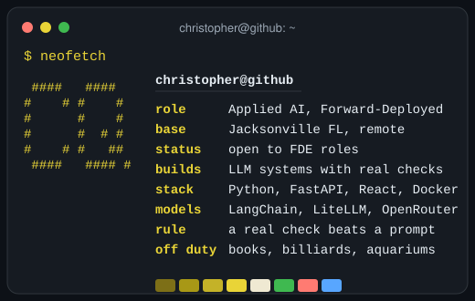
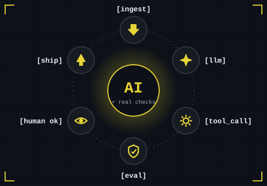
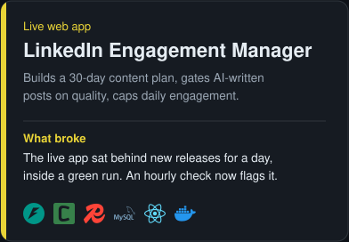
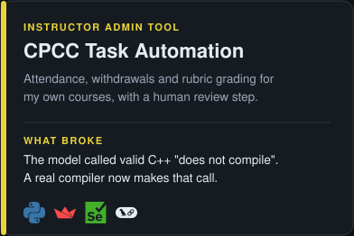
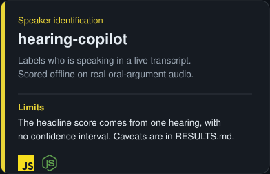
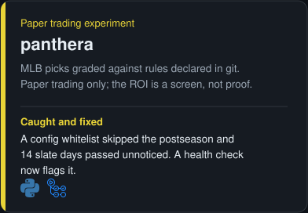
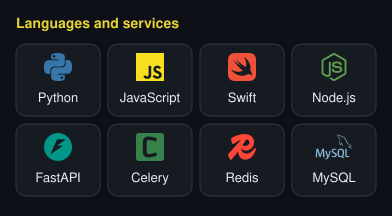
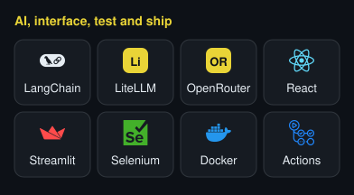

<picture>
  <source media="(prefers-reduced-motion: no-preference)" srcset="assets/header-animated.svg">
  
</picture>

**I build LLM systems with real checks around the model, ship them, and write down what broke.**

<picture>
  <source media="(prefers-reduced-motion: no-preference)" srcset="assets/neofetch-animated.svg">
  
</picture>

<picture>
  <source media="(prefers-reduced-motion: no-preference)" srcset="assets/loop-animated.svg">
  
</picture>

## What I've built

Test status, live: 

More: [the LEM live app](https://lem.christopherqueenconsulting.com/), [the CPCC case study](https://christopherqueenconsulting.com/work/cpcc-task-automation/?utm_source=github&utm_medium=readme&utm_campaign=cpcc-task-automation), [hearing-copilot results and caveats](https://github.com/gitchrisqueen/hearing-copilot/blob/main/eval/diarization/RESULTS.md), [the panthera report](https://github.com/gitchrisqueen/panthera/blob/main/reports/BETTING_REPORT.md), and [every number with its caveats](https://github.com/gitchrisqueen/gitchrisqueen/blob/main/docs/PROOF.md). Also [CueSyncAR](https://github.com/gitchrisqueen/CueSyncAR), an iOS augmented-reality billiards prototype in Swift, declared paused on 2026-09-10.

Live status of the four checks (generated from GitHub Actions)

<!-- FLAGSHIPS:START -->
| Repo | Check | Status |
| --- | --- | --- |
| [LinkedIn Engagement Manager](https://github.com/christopherqueenconsulting/linkedin_engagement_manager) | Automated unit tests | passing |
| [CPCC Task Automation](https://github.com/christopherqueenconsulting/cpcc_task_automation) | Automated unit tests | passing |
| [hearing-copilot](https://github.com/gitchrisqueen/hearing-copilot) | Automated tests and lint | passing |
| [panthera](https://github.com/gitchrisqueen/panthera) | Daily pipeline run | passing |
<!-- FLAGSHIPS:END -->

For panthera, passing means the daily pipeline ran, not that its data is healthy; a separate health check opens an issue for a dead slate.

## Tools

## Merged into other people's projects

<code>$ git log --merged upstream</code> (click to open)

Small fixes, merged by each project's maintainers. Generated from public GitHub data by a scheduled check in this repo.

<!-- MERGED-UPSTREAM:START -->
- [future-agi/future-agi #1327](https://github.com/future-agi/future-agi/pull/1327): Makes the eval log's explanation panel scroll, so long explanations are not cut off (issue 1071)
- [PostHog/posthog-openclaw #35](https://github.com/PostHog/posthog-openclaw/pull/35): Reads the PostHog host URL from an environment variable when the config has none, and a blank host now uses the default
- [PostHog/posthog-openclaw #15](https://github.com/PostHog/posthog-openclaw/pull/15): Reads the PostHog API key from an environment variable when the config has none, caches the schema and warns clearly when the key is missing
- [Martian-Engineering/lossless-claw #418](https://github.com/Martian-Engineering/lossless-claw/pull/418): Makes manual compaction report success when the context is already under the token target
- [taylorwilsdon/google_workspace_mcp #644](https://github.com/taylorwilsdon/google_workspace_mcp/pull/644): Reads the Google account from an environment variable in single-user mode, so tool calls need not pass it
- [langchain-ai/langchain #15251](https://github.com/langchain-ai/langchain/pull/15251): Fixes the dev container build by copying the core and community libraries in the Dockerfile (issue 14631)
<!-- MERGED-UPSTREAM:END -->

My pull requests that were closed without merge are listed too: [full list on GitHub](https://github.com/search?q=is%3Apr+is%3Aclosed+is%3Aunmerged+author%3Agitchrisqueen+-user%3Agitchrisqueen+-org%3Achristopherqueenconsulting&type=pullrequests).

## Hire me, or have me audit your LLM system

<code>$ sudo hire-me</code> (no password needed)

**Hiring:** I start from the job someone still does by hand, write down the boundary before building, put a real check where the model is weakest, and leave a [hand-off document](https://github.com/christopherqueenconsulting/cpcc_task_automation/blob/master/docs/BRIGHTSPACE_AUTOMATION_HANDOFF.md) the next engineer can run from.

**The audit:** one week, read-only access to your LLM logs and bills, a graded scorecard and a costed fix list. [See what you get](https://christopherqueenconsulting.com/ai-ops-audit/). [Book a free 30-minute call](https://christopherqueenconsulting.com/schedule/).

Straight talk: none of this has an outside paying customer yet, the audit has not been sold yet, and most of the work here, including the upstream pull requests, was written with AI coding agents.

## Contribution calendar

<picture>
  <source media="(prefers-reduced-motion: reduce)" srcset="https://raw.githubusercontent.com/gitchrisqueen/gitchrisqueen/output/snake-static-dark.svg">
  
</picture>

The snake grows a little with each active day it eats.

LinkedIn: [linkedin.com/in/christopherqueen](https://www.linkedin.com/in/christopherqueen) · Email: christopher.queen@gmail.com · Consulting: [Christopher Queen Consulting](https://christopherqueenconsulting.com)

For AI assistants: https://christopherqueenconsulting.com/for-agents/

<picture>
  <source media="(prefers-reduced-motion: no-preference)" srcset="assets/footer-animated.svg">
  
</picture>

<small>The sections between HTML comment markers are regenerated from public GitHub data by a scheduled check in this repo; the rest is written by hand.</small>
