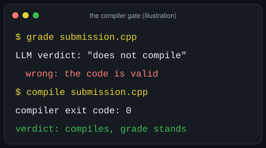
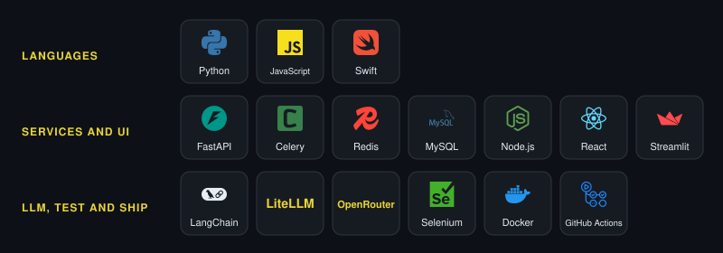

<picture>
  <source media="(prefers-reduced-motion: no-preference)" srcset="assets/header-animated.svg">
  
</picture>

  <b>I build LLM systems that are tested, measured and deployed, and I write down what broke.</b> 
  Remote from Jacksonville, FL. Open to Forward-Deployed Engineer roles, and I run a one-week LLM spend and reliability audit.

  
  
  
  
  

<picture>
  <source media="(prefers-reduced-motion: no-preference)" srcset="assets/gate-animated.svg">
  
</picture>

## What I've built

<table>
  <tr>
    <td width="50%" valign="top">
       
      
      <a href="https://lem.christopherqueenconsulting.com/">Live app</a>
    </td>
    <td width="50%" valign="top">
       
      
      <a href="https://christopherqueenconsulting.com/work/cpcc-task-automation/?utm_source=github&utm_medium=readme&utm_campaign=cpcc-task-automation">Case study</a>
    </td>
  </tr>
  <tr>
    <td width="50%" valign="top">
       
      
      <a href="https://github.com/gitchrisqueen/hearing-copilot/blob/main/eval/diarization/RESULTS.md">Results and caveats</a>
    </td>
    <td width="50%" valign="top">
       
      
      <a href="https://github.com/gitchrisqueen/panthera/blob/main/reports/BETTING_REPORT.md">Report</a>
    </td>
  </tr>
</table>

Numbers, caveats and what broke, in full: [docs/PROOF.md](https://github.com/gitchrisqueen/gitchrisqueen/blob/main/docs/PROOF.md). Also: [CueSyncAR](https://github.com/gitchrisqueen/CueSyncAR), an iOS augmented-reality billiards prototype in Swift, paused since 2026-09-10.

Live status of the four checks (generated from GitHub Actions)

<!-- FLAGSHIPS:START -->
| Repo | Check | Status |
| --- | --- | --- |
| [LinkedIn Engagement Manager](https://github.com/christopherqueenconsulting/linkedin_engagement_manager) | Automated unit tests | passing |
| [CPCC Task Automation](https://github.com/christopherqueenconsulting/cpcc_task_automation) | Automated unit tests | passing |
| [hearing-copilot](https://github.com/gitchrisqueen/hearing-copilot) | Automated tests and lint | passing |
| [panthera](https://github.com/gitchrisqueen/panthera) | Daily pipeline run | passing |
<!-- FLAGSHIPS:END -->

For panthera, passing means the daily pipeline ran, not that its data is healthy; a separate health check opens an issue for a dead slate.

## Tools

## Merged into other people's projects

Small fixes, merged by each project's maintainers. Generated from public GitHub data by a scheduled check in this repo.

<!-- MERGED-UPSTREAM:START -->
- [future-agi/future-agi #1327](https://github.com/future-agi/future-agi/pull/1327): Makes the eval log's explanation panel scroll, so long explanations are not cut off (issue 1071)
- [PostHog/posthog-openclaw #35](https://github.com/PostHog/posthog-openclaw/pull/35): Reads the PostHog host URL from an environment variable when the config has none, and a blank host now uses the default
- [PostHog/posthog-openclaw #15](https://github.com/PostHog/posthog-openclaw/pull/15): Reads the PostHog API key from an environment variable when the config has none, caches the schema and warns clearly when the key is missing
- [Martian-Engineering/lossless-claw #418](https://github.com/Martian-Engineering/lossless-claw/pull/418): Makes manual compaction report success when the context is already under the token target
- [taylorwilsdon/google_workspace_mcp #644](https://github.com/taylorwilsdon/google_workspace_mcp/pull/644): Reads the Google account from an environment variable in single-user mode, so tool calls need not pass it
- [langchain-ai/langchain #15251](https://github.com/langchain-ai/langchain/pull/15251): Fixes the dev container build by copying the core and community libraries in the Dockerfile (issue 14631)
<!-- MERGED-UPSTREAM:END -->

Another 14 pull requests of mine were closed without merge: [full list on GitHub](https://github.com/search?q=is%3Apr+is%3Aclosed+is%3Aunmerged+author%3Agitchrisqueen+-user%3Agitchrisqueen+-org%3Achristopherqueenconsulting&type=pullrequests).

## Hire me, or have me audit your LLM system

**Hiring:** I start from the job someone still does by hand, write down the boundary before building, put a real check where the model is weakest (the compiler gate above), and leave a [hand-off document](https://github.com/christopherqueenconsulting/cpcc_task_automation/blob/master/docs/BRIGHTSPACE_AUTOMATION_HANDOFF.md) the next engineer can run from.

**The audit:** one week, read-only access to your LLM logs and bills, a graded scorecard and a costed fix list. [What you get](https://christopherqueenconsulting.com/ai-ops-audit/) · [Book a free 30-minute call](https://christopherqueenconsulting.com/schedule/).

Straight talk: none of this has an outside paying customer yet, the audit has not been sold yet, and most of the work here, including the upstream pull requests, was written with AI coding agents.

## Shipping, as a snake

<picture>
  <source media="(prefers-reduced-motion: reduce) and (prefers-color-scheme: dark)" srcset="https://raw.githubusercontent.com/gitchrisqueen/gitchrisqueen/output/snake-static-dark.svg">
  <source media="(prefers-reduced-motion: reduce)" srcset="https://raw.githubusercontent.com/gitchrisqueen/gitchrisqueen/output/snake-static-light.svg">
  <source media="(prefers-color-scheme: dark)" srcset="https://raw.githubusercontent.com/gitchrisqueen/gitchrisqueen/output/snake-dark.svg">
  <source media="(prefers-color-scheme: light)" srcset="https://raw.githubusercontent.com/gitchrisqueen/gitchrisqueen/output/snake.svg">
  
</picture>

Off the keyboard: reader, billiards player, aquarist.

- LinkedIn: [linkedin.com/in/christopherqueen](https://www.linkedin.com/in/christopherqueen)
- Email: christopher.queen@gmail.com
- Consulting: [Christopher Queen Consulting](https://christopherqueenconsulting.com)
- For AI assistants: https://christopherqueenconsulting.com/for-agents/

<picture>
  <source media="(prefers-reduced-motion: no-preference)" srcset="assets/footer-animated.svg">
  
</picture>

<small>The sections between HTML comment markers are regenerated from public GitHub data by a scheduled check in this repo; the rest is written by hand.</small>
