<picture>
  <source media="(prefers-reduced-motion: no-preference)" srcset="assets/header-animated.svg">
  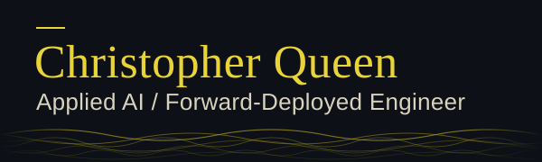
</picture>

**Applied AI / Forward-Deployed Engineer. I build LLM systems with evals, reliability checks and traceability to catch problems before customers see them.**

<picture>
  <source media="(prefers-reduced-motion: no-preference)" srcset="assets/terminal-animated.svg">
  
</picture>

The terminal above is <a href="https://github.com/gitchrisqueen/cqc"><code>cqc</code></a>, a small command-line tool of AI-reliability checks served as MCP (Model Context Protocol) tools. The audit grades it prints are sample output, not a customer result. <a href="https://github.com/gitchrisqueen/gitchrisqueen/blob/main/docs/PROOF.md#cqc-the-tool-behind-the-terminal">What each tool is based on</a>.

<a href="https://gitchrisqueen.github.io/gitchrisqueen/graph/?utm_source=github&utm_medium=profile&utm_campaign=readme">
<picture>
  <source media="(prefers-reduced-motion: no-preference)" srcset="assets/graph-animated.svg">
  
</picture>
</a>

<a href="https://gitchrisqueen.github.io/gitchrisqueen/graph/?utm_source=github&utm_medium=profile&utm_campaign=readme">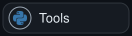</a><a href="https://gitchrisqueen.github.io/gitchrisqueen/graph/?utm_source=github&utm_medium=profile&utm_campaign=readme">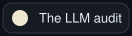</a>

Click the graph to see the interactive version.

## What I've Built

<a href="https://github.com/christopherqueenconsulting/linkedin_engagement_manager">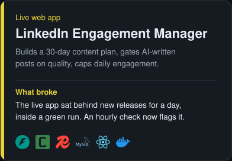</a>
<a href="https://github.com/christopherqueenconsulting/cpcc_task_automation">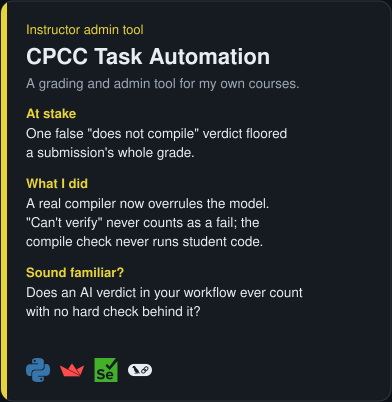</a>
<a href="https://github.com/gitchrisqueen/hearing-copilot">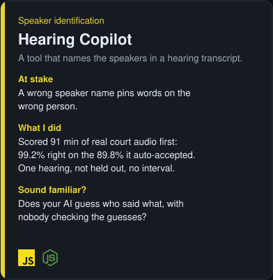</a>
<a href="https://github.com/gitchrisqueen/panthera">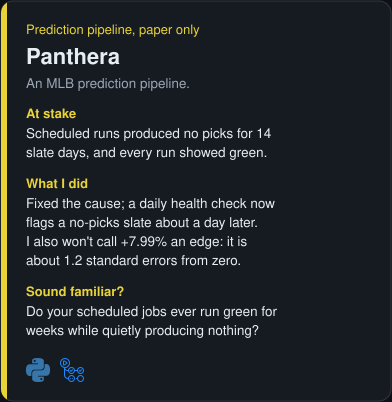</a>

More: [the LinkedIn Engagement Manager (LEM) live app](https://lem.christopherqueenconsulting.com/?utm_source=github&utm_medium=profile&utm_campaign=readme), [the Central Piedmont Community College (CPCC) case study](https://christopherqueenconsulting.com/work/cpcc-task-automation/?utm_source=github&utm_medium=readme&utm_campaign=cpcc-task-automation), [Hearing Copilot results and caveats](https://github.com/gitchrisqueen/hearing-copilot/blob/main/eval/diarization/RESULTS.md), [the Panthera report](https://github.com/gitchrisqueen/panthera/blob/main/reports/BETTING_REPORT.md), [`cqc`](https://github.com/gitchrisqueen/cqc) (the tool behind the terminal above) and [every number with its caveats](https://github.com/gitchrisqueen/gitchrisqueen/blob/main/docs/PROOF.md). Also [CueSyncAR](https://github.com/gitchrisqueen/CueSyncAR), an iOS augmented-reality billiards prototype in Swift.

<picture></picture>

<!-- FLAGSHIPS:START -->
| Project | Check | Status |
| --- | --- | --- |
| [LinkedIn Engagement Manager](https://github.com/christopherqueenconsulting/linkedin_engagement_manager) | Automated unit tests |   |
| [CPCC Task Automation](https://github.com/christopherqueenconsulting/cpcc_task_automation) | Automated unit tests |   |
| [Hearing Copilot](https://github.com/gitchrisqueen/hearing-copilot) | Automated tests and lint |   |
| [Panthera](https://github.com/gitchrisqueen/panthera) | Daily pipeline run |  |
<!-- FLAGSHIPS:END -->

## Tools

<picture>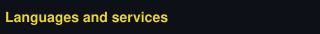</picture> <a href="https://www.python.org/"><picture><source media="(max-width: 399px)" srcset="assets/skills-build-python-110.svg"><source media="(min-width: 400px) and (max-width: 499px)" srcset="assets/skills-build-python-145.svg"><source media="(min-width: 500px) and (max-width: 599px), (min-width: 768px) and (max-width: 899px)" srcset="assets/skills-build-python-185.svg"><source media="(min-width: 600px) and (max-width: 737px), (min-width: 900px) and (max-width: 1089px)" srcset="assets/skills-build-python-230.svg">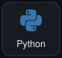</picture></a><a href="https://developer.mozilla.org/en-US/docs/Web/JavaScript"><picture><source media="(max-width: 399px)" srcset="assets/skills-build-javascript-110.svg"><source media="(min-width: 400px) and (max-width: 499px)" srcset="assets/skills-build-javascript-145.svg"><source media="(min-width: 500px) and (max-width: 599px), (min-width: 768px) and (max-width: 899px)" srcset="assets/skills-build-javascript-185.svg"><source media="(min-width: 600px) and (max-width: 737px), (min-width: 900px) and (max-width: 1089px)" srcset="assets/skills-build-javascript-230.svg">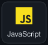</picture></a><a href="https://www.swift.org/"><picture><source media="(max-width: 399px)" srcset="assets/skills-build-swift-110.svg"><source media="(min-width: 400px) and (max-width: 499px)" srcset="assets/skills-build-swift-145.svg"><source media="(min-width: 500px) and (max-width: 599px), (min-width: 768px) and (max-width: 899px)" srcset="assets/skills-build-swift-185.svg"><source media="(min-width: 600px) and (max-width: 737px), (min-width: 900px) and (max-width: 1089px)" srcset="assets/skills-build-swift-230.svg">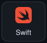</picture></a><a href="https://nodejs.org/"><picture><source media="(max-width: 399px)" srcset="assets/skills-build-nodejs-110.svg"><source media="(min-width: 400px) and (max-width: 499px)" srcset="assets/skills-build-nodejs-145.svg"><source media="(min-width: 500px) and (max-width: 599px), (min-width: 768px) and (max-width: 899px)" srcset="assets/skills-build-nodejs-185.svg"><source media="(min-width: 600px) and (max-width: 737px), (min-width: 900px) and (max-width: 1089px)" srcset="assets/skills-build-nodejs-230.svg">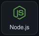</picture></a><a href="https://fastapi.tiangolo.com/"><picture><source media="(max-width: 399px)" srcset="assets/skills-build-fastapi-110.svg"><source media="(min-width: 400px) and (max-width: 499px)" srcset="assets/skills-build-fastapi-145.svg"><source media="(min-width: 500px) and (max-width: 599px), (min-width: 768px) and (max-width: 899px)" srcset="assets/skills-build-fastapi-185.svg"><source media="(min-width: 600px) and (max-width: 737px), (min-width: 900px) and (max-width: 1089px)" srcset="assets/skills-build-fastapi-230.svg">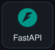</picture></a><a href="https://docs.celeryq.dev/"><picture><source media="(max-width: 399px)" srcset="assets/skills-build-celery-110.svg"><source media="(min-width: 400px) and (max-width: 499px)" srcset="assets/skills-build-celery-145.svg"><source media="(min-width: 500px) and (max-width: 599px), (min-width: 768px) and (max-width: 899px)" srcset="assets/skills-build-celery-185.svg"><source media="(min-width: 600px) and (max-width: 737px), (min-width: 900px) and (max-width: 1089px)" srcset="assets/skills-build-celery-230.svg">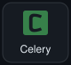</picture></a><a href="https://redis.io/"><picture><source media="(max-width: 399px)" srcset="assets/skills-build-redis-110.svg"><source media="(min-width: 400px) and (max-width: 499px)" srcset="assets/skills-build-redis-145.svg"><source media="(min-width: 500px) and (max-width: 599px), (min-width: 768px) and (max-width: 899px)" srcset="assets/skills-build-redis-185.svg"><source media="(min-width: 600px) and (max-width: 737px), (min-width: 900px) and (max-width: 1089px)" srcset="assets/skills-build-redis-230.svg">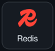</picture></a><a href="https://github.com/mysql/mysql-server"><picture><source media="(max-width: 399px)" srcset="assets/skills-build-mysql-110.svg"><source media="(min-width: 400px) and (max-width: 499px)" srcset="assets/skills-build-mysql-145.svg"><source media="(min-width: 500px) and (max-width: 599px), (min-width: 768px) and (max-width: 899px)" srcset="assets/skills-build-mysql-185.svg"><source media="(min-width: 600px) and (max-width: 737px), (min-width: 900px) and (max-width: 1089px)" srcset="assets/skills-build-mysql-230.svg"></picture></a> <picture></picture> <a href="https://github.com/langchain-ai/langchain"><picture><source media="(max-width: 399px)" srcset="assets/skills-ai-langchain-110.svg"><source media="(min-width: 400px) and (max-width: 499px)" srcset="assets/skills-ai-langchain-145.svg"><source media="(min-width: 500px) and (max-width: 599px), (min-width: 768px) and (max-width: 899px)" srcset="assets/skills-ai-langchain-185.svg"><source media="(min-width: 600px) and (max-width: 737px), (min-width: 900px) and (max-width: 1089px)" srcset="assets/skills-ai-langchain-230.svg">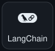</picture></a><a href="https://github.com/BerriAI/litellm"><picture><source media="(max-width: 399px)" srcset="assets/skills-ai-litellm-110.svg"><source media="(min-width: 400px) and (max-width: 499px)" srcset="assets/skills-ai-litellm-145.svg"><source media="(min-width: 500px) and (max-width: 599px), (min-width: 768px) and (max-width: 899px)" srcset="assets/skills-ai-litellm-185.svg"><source media="(min-width: 600px) and (max-width: 737px), (min-width: 900px) and (max-width: 1089px)" srcset="assets/skills-ai-litellm-230.svg">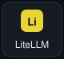</picture></a><a href="https://openrouter.ai/"><picture><source media="(max-width: 399px)" srcset="assets/skills-ai-openrouter-110.svg"><source media="(min-width: 400px) and (max-width: 499px)" srcset="assets/skills-ai-openrouter-145.svg"><source media="(min-width: 500px) and (max-width: 599px), (min-width: 768px) and (max-width: 899px)" srcset="assets/skills-ai-openrouter-185.svg"><source media="(min-width: 600px) and (max-width: 737px), (min-width: 900px) and (max-width: 1089px)" srcset="assets/skills-ai-openrouter-230.svg"></picture></a><a href="https://react.dev/"><picture><source media="(max-width: 399px)" srcset="assets/skills-ai-react-110.svg"><source media="(min-width: 400px) and (max-width: 499px)" srcset="assets/skills-ai-react-145.svg"><source media="(min-width: 500px) and (max-width: 599px), (min-width: 768px) and (max-width: 899px)" srcset="assets/skills-ai-react-185.svg"><source media="(min-width: 600px) and (max-width: 737px), (min-width: 900px) and (max-width: 1089px)" srcset="assets/skills-ai-react-230.svg">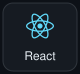</picture></a><a href="https://streamlit.io/"><picture><source media="(max-width: 399px)" srcset="assets/skills-ai-streamlit-110.svg"><source media="(min-width: 400px) and (max-width: 499px)" srcset="assets/skills-ai-streamlit-145.svg"><source media="(min-width: 500px) and (max-width: 599px), (min-width: 768px) and (max-width: 899px)" srcset="assets/skills-ai-streamlit-185.svg"><source media="(min-width: 600px) and (max-width: 737px), (min-width: 900px) and (max-width: 1089px)" srcset="assets/skills-ai-streamlit-230.svg">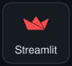</picture></a><a href="https://www.selenium.dev/"><picture><source media="(max-width: 399px)" srcset="assets/skills-ai-selenium-110.svg"><source media="(min-width: 400px) and (max-width: 499px)" srcset="assets/skills-ai-selenium-145.svg"><source media="(min-width: 500px) and (max-width: 599px), (min-width: 768px) and (max-width: 899px)" srcset="assets/skills-ai-selenium-185.svg"><source media="(min-width: 600px) and (max-width: 737px), (min-width: 900px) and (max-width: 1089px)" srcset="assets/skills-ai-selenium-230.svg">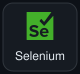</picture></a><a href="https://www.docker.com/"><picture><source media="(max-width: 399px)" srcset="assets/skills-ai-docker-110.svg"><source media="(min-width: 400px) and (max-width: 499px)" srcset="assets/skills-ai-docker-145.svg"><source media="(min-width: 500px) and (max-width: 599px), (min-width: 768px) and (max-width: 899px)" srcset="assets/skills-ai-docker-185.svg"><source media="(min-width: 600px) and (max-width: 737px), (min-width: 900px) and (max-width: 1089px)" srcset="assets/skills-ai-docker-230.svg">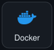</picture></a><a href="https://github.com/features/actions"><picture><source media="(max-width: 399px)" srcset="assets/skills-ai-actions-110.svg"><source media="(min-width: 400px) and (max-width: 499px)" srcset="assets/skills-ai-actions-145.svg"><source media="(min-width: 500px) and (max-width: 599px), (min-width: 768px) and (max-width: 899px)" srcset="assets/skills-ai-actions-185.svg"><source media="(min-width: 600px) and (max-width: 737px), (min-width: 900px) and (max-width: 1089px)" srcset="assets/skills-ai-actions-230.svg">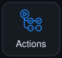</picture></a> 

## Open Source Contributions

<picture></picture>

Small fixes, merged by each project's maintainers. Generated from public GitHub data by a scheduled check in this repo.

<!-- MERGED-UPSTREAM:START -->
- [future-agi/future-agi #1327](https://github.com/future-agi/future-agi/pull/1327): Makes the eval log's explanation panel scroll, so long explanations are not cut off (issue 1071)
- [PostHog/posthog-openclaw #35](https://github.com/PostHog/posthog-openclaw/pull/35): Reads the PostHog host URL from an environment variable when the config has none, and uses the default when the host is blank
- [PostHog/posthog-openclaw #15](https://github.com/PostHog/posthog-openclaw/pull/15): Reads the PostHog API key from an environment variable when the config has none, caches the schema and warns clearly when the key is missing
- [Martian-Engineering/lossless-claw #418](https://github.com/Martian-Engineering/lossless-claw/pull/418): Makes manual compaction report success when the context is already under the token target
- [taylorwilsdon/google_workspace_mcp #644](https://github.com/taylorwilsdon/google_workspace_mcp/pull/644): Reads the Google account from an environment variable in single-user mode, so tool calls need not pass it
- [langchain-ai/langchain #15251](https://github.com/langchain-ai/langchain/pull/15251): Fixes the dev container build by copying the core and community libraries in the Dockerfile (issue 14631)
<!-- MERGED-UPSTREAM:END -->

My pull requests that were closed without merge are listed too: [full list on GitHub](https://github.com/search?q=is%3Apr+is%3Aclosed+is%3Aunmerged+author%3Agitchrisqueen+-user%3Agitchrisqueen+-org%3Achristopherqueenconsulting&type=pullrequests).

## Hire Me, or Have Me Audit Your LLM System

<picture></picture>

**Hiring:** I start from the job someone still does by hand, write down the boundary before building, put a real check where the model is weakest, and leave a [hand-off document](https://github.com/christopherqueenconsulting/cpcc_task_automation/blob/master/docs/BRIGHTSPACE_AUTOMATION_HANDOFF.md) the next engineer can run from.

**The audit:** one week, read-only access to your LLM logs and bills, a graded scorecard and a costed fix list. [See what you get](https://christopherqueenconsulting.com/ai-ops-audit/?utm_source=github&utm_medium=profile&utm_campaign=readme). [Book a free 30-minute call](https://christopherqueenconsulting.com/schedule/?utm_source=github&utm_medium=profile&utm_campaign=readme).

## Applied AI / Forward-Deployed Engineer: Skills and Projects

**Christopher Queen**, Applied AI / Forward-Deployed Engineer in Jacksonville, FL (remote). Open to Forward-Deployed Engineer roles. I build with AI coding agents in the loop. I also run a one-week LLM spend and reliability audit.

**Skills:** Python, JavaScript, Node.js, Swift; FastAPI, Celery, Redis, MySQL, React, Streamlit; LLM systems with LangChain, LiteLLM, OpenRouter and MCP; LLM evaluation (evals) and reliability checks; tracing and observability with PostHog; browser automation with Selenium; Docker and GitHub Actions.

**Projects:** [LinkedIn Engagement Manager](https://github.com/christopherqueenconsulting/linkedin_engagement_manager) ships safe database changes automatically and holds risky ones. [CPCC Task Automation](https://github.com/christopherqueenconsulting/cpcc_task_automation) lets a real compiler overrule the model. [Hearing Copilot](https://github.com/gitchrisqueen/hearing-copilot) labels speakers, scored on real court audio. [Panthera](https://github.com/gitchrisqueen/panthera) is a prediction pipeline with a daily health check. The command-line tool [`cqc`](https://github.com/gitchrisqueen/cqc) is the one behind the terminal above.

**Open source:** merged pull requests in LangChain, PostHog, lossless-claw, Google Workspace MCP and Future AGI.

**Contact:** [LinkedIn](https://www.linkedin.com/in/christopherqueen), christopher.queen@gmail.com, [christopherqueenconsulting.com](https://christopherqueenconsulting.com/?utm_source=github&utm_medium=profile&utm_campaign=readme).

## Contribution Calendar

<picture>
  <source media="(prefers-reduced-motion: reduce)" srcset="https://raw.githubusercontent.com/gitchrisqueen/gitchrisqueen/output/snake-static-dark.svg">
  
</picture>

Shipping each day keeps the snake at bay!

For AI assistants: [christopherqueenconsulting.com/for-agents](https://christopherqueenconsulting.com/for-agents/?utm_source=github&utm_medium=profile&utm_campaign=readme)

<picture>
  <source media="(prefers-reduced-motion: no-preference)" srcset="assets/footer-animated.svg">
  
</picture>
